<p align="center">
  <a href="https://github.com/MahmoudAshraf19/wanisy-web">
    
  </a>
</p>

<h1 align="center">Waneesi (ونيسي) — Official Enterprise Web Platform</h1>

<p align="center">
  <strong>Next-Generation Full-Stack Web Platform & Digital Gateway for the Global Pet Care Ecosystem</strong>
</p>

<p align="center">
  <a href="https://react.dev/"></a>
  <a href="https://www.typescriptlang.org/"></a>
  <a href="https://tanstack.com/start"></a>
  <a href="https://tailwindcss.com/"></a>
  <a href="https://vitejs.dev/"></a>
  <a href="https://nitro.unjs.io/"></a>
</p>

---

## 📌 Executive Summary

**Waneesi (ونيسي)** is an enterprise-grade digital ecosystem bridging pet owners, certified veterinary doctors, medical clinics, professional groomers, pet hotels, and pet supply merchants into a unified, interactive network.

This web platform serves as the public-facing flagship web infrastructure for the ecosystem. Architected from the ground up for high-throughput SEO discovery, instant load times, and international accessibility, the platform leverages **React 19 Server-Side Rendering (SSR)** via **TanStack Start**, cutting-edge **Tailwind CSS v4**, strict compile-time type safety with **TypeScript 5.8**, and an interactive multi-phase vector projection engine for global geographic rollout tracking.

---

## 🏛️ Architectural Highlights & Engineering Excellence

```
                                  ┌──────────────────────────────┐
                                  │      Client (Browser)        │
                                  └──────────────┬───────────────┘
                                                 │ HTTP/3 / SSR Hydration
                                                 ▼
┌────────────────────────────────────────────────────────────────────────────────────────┐
│                                 Nitro Server Layer                                     │
├────────────────────────────────────────────────────────────────────────────────────────┤
│  ┌───────────────────────┐   ┌─────────────────────────┐   ┌────────────────────────┐  │
│  │   TanStack Start SSR  │───│  TanStack Router (TS)   │───│  Zod Schema Validation │  │
│  └───────────────────────┘   └─────────────────────────┘   └────────────────────────┘  │
│  ┌───────────────────────┐   ┌─────────────────────────┐   ┌────────────────────────┐  │
│  │  Bidirectional i18n   │───│ Design Tokens (TW v4)   │───│ Radix UI Accessibility │  │
│  │   (Arabic RTL / LTR)  │   │   (Tailwind Modern)     │   │     (WAI-ARIA Spec)    │  │
│  └───────────────────────┘   └─────────────────────────┘   └────────────────────────┘  │
└────────────────────────────────────────────────────────────────────────────────────────┘
                                                 │
                                                 ▼
┌────────────────────────────────────────────────────────────────────────────────────────┐
│                              Interactive Visualizations                                │
├────────────────────────────────────────┬───────────────────────────────────────────────┤
│  Google Maps JavaScript API Engine     │  Custom SVG World Projection Geometry         │
│  • Dynamic Cairo HQ Beacon & Pulse     │  • 4-Phase Geospatial Rollout Engine          │
│  • Navigation Directions & GPS Lat/Lng │  • Zero Heavy GIS Dependencies, <200KB Pure SVG│
└────────────────────────────────────────┴───────────────────────────────────────────────┘
```

### 1. End-to-End Compile-Time Type Safety
- **Strict Mode Activated**: Enforced `noUncheckedIndexedAccess`, `strictNullChecks`, and zero runtime any-casting.
- **Type-Safe Routing**: Full integration with **TanStack Router**, ensuring all link paths, search parameters, params, and route transitions are validated at compile time.
- **Schema Contracts**: Runtime data validation handled seamlessly via **Zod**, guaranteeing resilient client-server boundaries.

### 2. High-Performance Server-Side Rendering (SSR) & Edge-Ready
- **Modern Hydration Pipeline**: Built on **TanStack Start** with streaming SSR and progressive hydration.
- **Zero-Flicker Layout Engine**: Fast First Contentful Paint (FCP) and near-perfect Cumulative Layout Shift (CLS) scores across mobile and desktop viewports.
- **Vite 8 & Nitro Runtime**: Blazing fast cold-start builds and deployment flexibility across Node.js, Cloudflare Workers, Vercel, or standalone Docker containers.

### 3. Native Bidirectional Internationalization (i18n)
- **Fluid Arabic (RTL) & English (LTR)**: Complete layout inversion, dynamic typography adaptation, and localized metadata handling without page reloads.
- **Typography Calibration**: Context-sensitive typography scaling optimized for Arabic scripts and Latin fonts.

### 4. Advanced Geospatial & Expansion Vector Visualizer
- **Live Headquarters Engine**: Google Maps JavaScript API integration displaying Waneesi’s core operating hub in Cairo, Egypt, complete with customized canvas pulsing markers, real-time geocoding, and GPS routing.
- **Custom SVG Global Expansion Map**: A bespoke vector-based world map component with high-performance projection algorithms (`ExpansionMap.tsx` and `world-map-data.ts`). Renders 4 progressive expansion phases without bulky third-party mapping libraries.

### 5. Inclusive Accessibility (a11y) & Design Systems
- **Headless UI Primitives**: Constructed with **Radix UI**, providing full compliance with WAI-ARIA guidelines, keyboard navigation, and screen-reader friendliness.
- **Adaptive Theme Tokens**: Seamless transition between Dark and Light modes without flash of unstyled content (FOUC), calibrated against WCAG 2.1 AAA contrast benchmarks.

---

## 🌟 Key Platform Modules

| Module | Technical Capabilities |
| :--- | :--- |
| **Comprehensive Health & Life Hub** | Interactive showcase of pet profiles, vaccination logs, microchip identification, and digital medical record storage. |
| **Veterinary & Clinical Directory** | Gateway for licensed clinics, veterinary hospitals, and 24/7 triage emergencies with filterable capabilities. |
| **Certified Pet Hotels & Boarding** | Real-time amenity listings, species acceptance criteria, boarding packages, and verified hygiene certifications. |
| **Specialized Grooming Services** | Portal for certified mobile groomers and salon bookings with detailed service tiers. |
| **Ethical Adoption & Rescue** | Rescue matching platform bridging animal shelters, verified rescuers, and prospective pet parents. |
| **Global Expansion Roadmap** | Interactive 4-phase rollout tracking expansion across Egypt, the GCC, the European Union, and worldwide markets. |
| **Professional Partners Portal** | B2B onboarding gateway for veterinary professionals, clinic directors, pet store vendors, and service partners. |
| **Governance & User Data Rights** | Self-service account deletion interface (`/delete-account`), GDPR-aligned privacy policies, child safety guidelines, and terms of service. |

---

## 🧰 Technology Matrix

### Core Framework & Runtimes
- **Runtime & Library**: React 19.2.0 (React Server Components, Concurrent Features)
- **Framework**: TanStack Start (SSR, Server Functions, Streaming)
- **Routing Engine**: `@tanstack/react-router` (Type-safe file-based router)
- **Compilation & Bundling**: Vite 8.1.5, Nitro Server Engine

### State, Data & UI Tooling
- **Styling**: Tailwind CSS v4.2.1, `@tailwindcss/vite`, `tw-animate-css`
- **Headless UI**: `@radix-ui/react-*` (Dialog, Dropdown, Navigation, Tabs, Tooltip, Collapsible)
- **Icons**: Lucide React (`lucide-react`)
- **Data Validation**: Zod 3.25.x
- **Animation**: Framer Motion 14.x
- **Date Utilities**: Date-fns 4.x
- **Code Quality**: ESLint 9 (Flat Config), Prettier 3, TypeScript 5.8

---

## 📁 Repository Directory Structure

```text
wanisy-web/
├── public/                     # Static distribution assets
│   ├── brand/                  # High-resolution brand illustrations & vectors
│   ├── flags/                  # Internationalization country flag assets
│   ├── icons/                  # Official App Store, Google Play, & UI icons
│   ├── favicon.png             # Vector favicon
│   ├── logo.png                # Master Waneesi brand mark
│   └── sitemap.xml             # Search engine discovery index
├── src/
│   ├── components/
│   │   ├── layout/             # Master Navbar, Footer, Language & Theme switchers
│   │   ├── location/           # Geospatial Visualizers
│   │   │   ├── HeadquartersMap.tsx # Google Maps Cairo HQ with canvas pulse
│   │   │   └── ExpansionMap.tsx    # Interactive SVG Global Expansion engine
│   │   ├── sections/           # Modular landing page sections
│   │   │   ├── HeroSection.tsx
│   │   │   ├── FeaturesGridSection.tsx
│   │   │   ├── AudiencesSection.tsx
│   │   │   ├── ProfessionalsSection.tsx
│   │   │   ├── CommunityStorySection.tsx
│   │   │   ├── FaqSection.tsx
│   │   │   └── DownloadCtaSection.tsx
│   │   └── ui/                 # Accessible Radix-powered design system components
│   ├── lib/
│   │   ├── config.ts           # Centralized environment, brand colors & endpoint constants
│   │   ├── expansion.ts        # 4-Phase geospatial rollout data model
│   │   ├── i18n.ts             # English/Arabic translation dictionary
│   │   ├── legal.ts            # Regulatory and policy copy
│   │   ├── prefs.tsx           # Global Preferences context (Theme, Locale)
│   │   ├── utils.ts            # ClassName merging (`clsx` + `tailwind-merge`)
│   │   └── world-map-data.ts   # Optimized SVG vector topology for the world map
│   └── routes/                 # File-based TanStack routes
│       ├── __root.tsx          # Root document, HTML shell, meta tags & providers
│       ├── index.tsx           # Home landing page
│       ├── features.tsx        # In-depth 12-pillar feature directory
│       ├── for-professionals.tsx # B2B & Clinical partnership onboarding
│       ├── location.tsx        # Interactive headquarters & global expansion tracker
│       ├── contact.tsx         # Direct corporate & technical support contact portal
│       ├── delete-account.tsx  # User privacy & self-service data erasure flow
│       ├── privacy-policy.tsx  # Regulatory privacy disclosure
│       ├── terms-and-conditions.tsx # Terms of service agreement
│       ├── community-guidelines.tsx # Platform safety standards
│       └── child-safety.tsx    # Child protection & safeguarding policies
├── package.json                # Project manifest, dependencies & scripts
├── tsconfig.json               # Strict TypeScript configuration
├── vite.config.ts              # Vite plugins & TanStack compiler setup
└── README.md                   # Enterprise technical documentation
```

---

## ⚡ Quick Start Guide

### Prerequisites
- **Node.js**: `v20.12.0` or higher
- **Package Manager**: `npm` (v10+), `pnpm` (v9+), or `yarn` (v4+)

### 1. Clone & Navigate
```bash
git clone https://github.com/MahmoudAshraf19/wanisy-web.git
cd wanisy-web
```

### 2. Dependency Installation
```bash
npm install
```

### 3. Local Development Server
Start the development server with Hot Module Replacement (HMR):
```bash
npm run dev
```
Navigate to `http://localhost:3000` to inspect the application.

### 4. Quality Assurance & Static Analysis
```bash
# Type check all TypeScript files
npx tsc --noEmit

# Run ESLint validation
npm run lint

# Code formatting verification
npx prettier --check .
```

### 5. Production Compilation
Produce an optimized SSR production bundle:
```bash
npm run build
```

### 6. Production Preview
Preview the production build locally:
```bash
npm run preview
```

---

## 🌐 Enterprise Configuration

Environment settings and brand parameters are centralized in [`src/lib/config.ts`](src/lib/config.ts). Key parameters include:

```typescript
export const siteConfig = {
  name: "Waneesi",
  nameAr: "ونيسي",
  taglineEn: "Your Pet's World. All in One Place.",
  taglineAr: "كل عالم أليفك في مكان واحد",
  colors: {
    persianGreen: "#2A9D8F",
    sandyBrown: "#F4A261",
    saffron: "#E9C46A",
    burntSienna: "#E76F51",
    charcoal: "#264653",
  },
  headquarters: {
    cityEn: "Cairo",
    cityAr: "القاهرة",
    countryEn: "Egypt",
    latitude: 30.0444,
    longitude: 31.2357,
    googleMapsApiKey: process.env.VITE_GOOGLE_MAPS_API_KEY || "AIzaSy...",
  },
  contact: {
    generalEmail: "contact@waneesi.app",
    supportEmail: "support@waneesi.app",
    partnersEmail: "partners@waneesi.app",
  },
};
```

---

## 📈 Engineering Standards & Practices

- **Zero Unhandled Exceptions**: All async operations and boundary-crossing requests are wrapped in declarative Error Boundaries (`error-page.ts`).
- **Semantic HTML5**: Native structural tags (`<header>`, `<main>`, `<section>`, `<article>`, `<footer>`) to maximize accessibility and search engine indexing.
- **Tree-Shaking & Dead Code Elimination**: Zero unused bundle artifacts through Vite’s Rollup integration.
- **Modern Git Conventions**: Clean commit lineage using the Conventional Commits specification (`feat:`, `fix:`, `refactor:`, `perf:`).

---

## 👨‍💻 Engineering Lead & Author

**Mahmoud Ashraf**
- **GitHub**: [@MahmoudAshraf19](https://github.com/MahmoudAshraf19)
- **Repository**: [wanisy-web](https://github.com/MahmoudAshraf19/wanisy-web)
- **Role**: Software Engineer & Full-Stack Architect

---

<p align="center">
  <sub>© 2026 Waneesi (ونيسي) Technologies Inc. All rights reserved. Crafted with precision for the global pet community.</sub>
</p>
